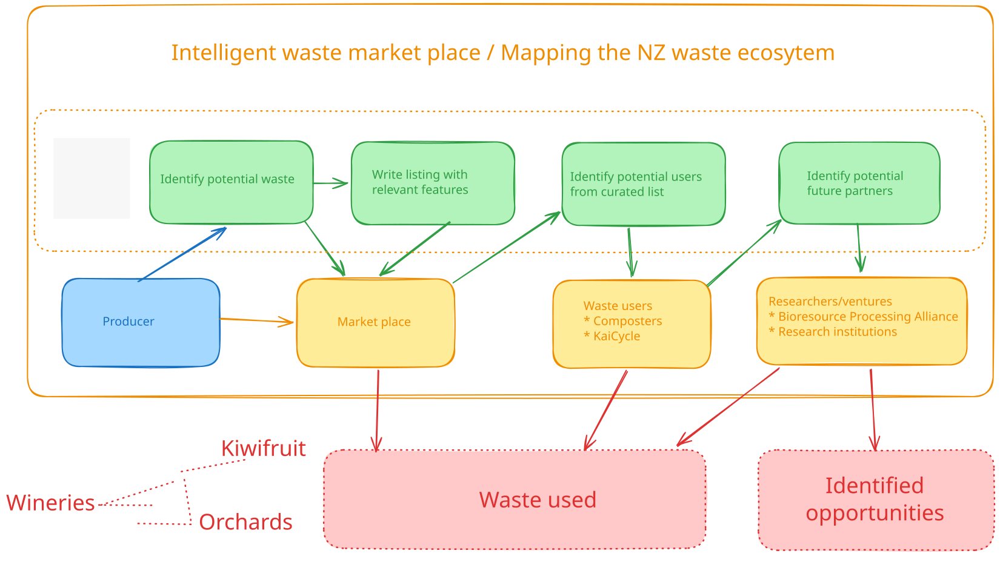

# Waste Opportunities

This project was part of the Aotearoa AI Hackathon 2026 in which my team were finalists. It was part of our pitch in which I was setting up agentic systems. It is heavily vibe coded due to the time constraints of the hackathon, however, it does illustrate some key principles for setting up agentic systems and productionising code.

A core idea of our hackathon pitch was to link an agentic system to a market place for unwanted primary industries waste. The workflow is shown below:

## Standalone agent testing

I set up a standalone webpage in which you can add an API key and explore the overall workflow. It is set up to use Claude Sonnet 4.6. For the curated potential users and future partners, there is a hard coded list within the JavaScript for testing the idea.

The addition of the API key is to allow others to download this standalone and play with the prototype agentic system. To run it, open the html file within the agent-flow-testing folder and input a Claude API key. When testing, it cost about 5 cents per complete workflow.

This is only developed for personal use as an API key needs to be supplied. The key stays in the browser, and no key is committed to the repo or served to anyone.

## Testing Pydantic AI

The testing of standalone agents is not suitable for production. To make it more realistic for the backend, the first step is using a more rigorous system. 

I have seen Pydantic AI and decided to use it because it is similar to Pydantic which I have been using on other projects. The features that I liked Pydantic AI for further testing is type-safe validation and retries, which is important for making sure the data is in the correct shape for the front-end, and being model agnostic allowing for other models to be selected. There are also other features as Pydantic AI is set up for production.

The `README.md` within the pydantic-AI-testing folder contains instructions to run agents using Pydantic AI with the command line. Due to time constraints during the hackathon, these were not linked into a front-end but show agents with schema validated output.

## Next steps

This was time pressured and for a hypothetical situation during a hackathon. There are a few issues that would be needed for the next steps. The top three in my opinion are:

1. While there are gaps in our circular bioeconomy, I think this system would likely not be that useful in practice. The first step in further development would be connecting with industry bodies, experts, local councils and potential users. This type of system touches on a lot of national and local regulation, and it would be best to identify actual users to ensure any tool we create is actually useful.

2. I played with a standalone front-end tool to quickly iterate agentic workflows and Pydantic AI to be closer to a production system. To take this further the agents would need to be linked into the proper frontend marketplace and a validated dataset created for the agents. Currently it is based on web searches whereas a lot of the value would be from connecting to validated sources of information. 

3. There would need to be proper budgeting. Currently, a single run through costs about 5 cents. That could quickly add up if there were many users. Further testing could try different models to determine the cheapest for each step. That is where good evals would be important to help with the cost/quality trade off.
